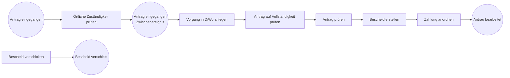

# Prüfbericht: `Test Review Agent Wohngeld beantragen`

> **Datei**: `Test Review Agent Wohngeld beantragen (de).bpmn`
> **ADONIS-Modell-ID / Version**: nicht aus ADONIS abgerufen / `0.01` (Status „In Bearbeitung“, laut Modellattribut `MFB_RWF_VERSION`)
> **Geprüft am**: 24.11.2026
> **Geprüft durch**: GovModeler_ADONIS_Review

---

## Zusammenfassung

| Kriterium | Ergebnis |
|---|---|
| **Gesamtbewertung** | `Nachbesserung erforderlich` |
| **Kritische Fehler** | `2` |
| **Warnungen** | `7` |
| **Hinweise** | `4` |

**Kritische Fehler**
1. Der Task „Bescheid verschicken“ hat keinen eingehenden Sequenzfluss. Der Pfad bis zum Ende „Bescheid verschickt“ ist nie erreichbar (toter Pfad).
2. Das Zwischenereignis „Antrag eingegangen“ (Nachrichten-Fänger) hat keinen eingehenden Nachrichtenfluss. Der Prozess würde dort dauerhaft warten (Deadlock). Das Ereignis dupliziert außerdem den Namen und die Bedeutung des Startereignisses.

**Warnungen**
1. Keine einzige Elementdokumentation (`documentation`) an den 7 Tasks.
2. Keine Gateways und keine Ausnahmepfade (unvollständiger Antrag, Unzuständigkeit, Ablehnung/Bewilligung).
3. Pool „LHS“ enthält eine Abkürzung. Der Modellname enthält den Testzusatz „Test Review Agent“.
4. Lane-Benennung ohne Geschäftszeichen. Keine Ressourcen-/Rollenzuweisung im Export erkennbar.
5. Keine Prozess-Stammdaten im Export (Analyst, methodischer Prüfer, Prozessmanager, Prozesseigner, Prozessbeschreibung, Gültigkeit).
6. Kein IT-System referenziert, obwohl der Task „Vorgang in DiWo anlegen“ ein Fachverfahren voraussetzt. Die Abkürzung „DiWo“ ist nicht erläutert.
7. Task „Antrag prüfen“ ist unspezifisch und überschneidet sich mit „Antrag auf Vollständigkeit prüfen“.

---

## 1. Pool-Struktur und Akteure

| Kriterium | Status | Befund |
|---|---|---|
| **Kunde-Pool** vorhanden (White- oder Black-Box) | ✅ | Pool „Kunde“ als Black-Box (`participant` mit leerem Prozess). Nachrichtenflüsse zum Startereignis und vom Task „Bescheid verschicken“ vorhanden. |
| **Organisation-Pool** vorhanden | ✅ | Pool „LHS“ mit Lanes „Poststelle“ und „Sachbearbeiter\*in“. Benennung mit Abkürzung, siehe MP5/MP7. |
| **IT-Pool** (optional, bewertet falls vorhanden) | ➖ | Nicht vorhanden. Ein IT-Pool ist nicht zwingend. Der Task „Vorgang in DiWo anlegen“ deutet auf IT-Unterstützung hin. Empfehlung: mindestens IT-System am Task referenzieren, ggf. Black-Box-IT-Pool. |

**Bewertung**: Die Pflichtpools sind vorhanden und korrekt untereinander angeordnet. Die Akteursmodellierung ist grundsätzlich tragfähig. Die Benennung des Organisationspools und der Lanes muss überarbeitet werden.

---

## 2. Prozessumfang und Verständlichkeit

**Schrittanzahl pro Pool**:

| Pool | Anzahl Tasks | Anzahl Gateways | Anzahl Events |
|---|---|---|---|
| Kunde (Black-Box) | 0 | 0 | 0 |
| Organisation (LHS) | 7 | 0 | 4 (1 Start, 2 Ende, 1 Zwischenereignis) |
| IT | – | – | – |

**Verständlichkeit**: Der Hauptpfad ist von links nach rechts lesbar und optisch einheitlich (gleiche Task-Größen, gleich lange Pools und Lanes). Die Lesbarkeit leidet unter drei Punkten. Der Task „Bescheid verschicken“ hängt ohne Verbindung im Modell. Es gibt zwei Endereignisse, davon eines unerreichbar. Das Zwischenereignis „Antrag eingegangen“ nach dem Startereignis gleichen Namens ist fachlich nicht nachvollziehbar. Ohne Elementdokumentation und ohne Gateways ist der Prozess fachlich unvollständig und nicht prüfbar.

**Empfehlungen zur Kompaktheit**: Keine Reduzierung nötig, der Umfang (7 Tasks) ist überschaubar. Das Modell soll fachlich vervollständigt werden (Gateways, Ausnahmen). „Vorgang in DiWo anlegen“ kann ggf. mit der Zuständigkeitsprüfung zu „Antrag erfassen“ gebündelt werden. Bei Ergänzung der Bewilligungs-/Ablehnungspfade sind Bescheid-Teilschritte ggf. in einen Subprozess auszulagern.

**Ablauf laut Modell**:

---

## Detaillierte Befunde

> **Legende**: ✅ Ja – Kriterium erfüllt | ❌ Nein – Kriterium verletzt | ➖ Nicht relevant

### Allgemeine Struktur

| MP-Nr. | Prüfkriterium | ✅ Ja | ❌ Nein | ➖ Nicht relevant | Bemerkung |
|---|---|:---:|:---:|:---:|---|
| MP1 | Enthält der Prozess keine personenbezogenen Daten? | ☑ | ☐ | ☐ | Prozessinhalt ohne personenbezogene Daten. Die Änderungshistorie (`MFB_RWF_HISTORY`) enthält den Namen des Modellierers, das ist ADONIS-Systemmetadatum. |
| MP2 | Ist der Prozess in der richtigen Ablagestruktur? | ☐ | ☐ | ☑ | Aus der Datei nicht prüfbar. |
| MP3 | Enthält der Prozess keine vertraulichen oder höher eingestuften Inhalte? | ☑ | ☐ | ☐ | |
| MP4 | Modellierungsrichtung einheitlich? (von links nach rechts bei BPMN) | ☑ | ☐ | ☐ | Hauptpfad strikt links → rechts. |
| MP5 | Ist der Prozessname aussagekräftig, enthält keine Abkürzungen und Paragrafen? | ☐ | ☑ | ☐ | Name enthält den Testzusatz „Test Review Agent“. Zielname: „Wohngeld beantragen“. |
| MP6 | Modell enthält nur einen Prozess, kein Mischmodell. | ☑ | ☐ | ☐ | Eine Collaboration, ein ausführender Prozess. |
| MP7 | Pool-Benennung korrekt? (Ggf. Externe über Blackbox/Whitebox-Pool kenntlich gemacht?) | ☐ | ☑ | ☐ | „Kunde“ als Black-Box korrekt. „LHS“ ist eine Abkürzung, Langform der Organisation verwenden. |
| MP8 | Mindestens eine Schwimmbahn (Lane) vorhanden und korrekt benannt? | ☑ | ☐ | ☐ | Zwei Lanes vorhanden, Benennung siehe MP17. |
| MP9 | Prozessanalyst/-modellierer eingetragen? | ☐ | ☑ | ☐ | Kein entsprechendes Attribut im Export. Nur Eintrag in der Änderungshistorie. |
| MP10 | 17-3.4 ADONIS-Team als methodischer Prüfer eingetragen? | ☐ | ☑ | ☐ | Nicht im Modell erkennbar. |
| MP11 | Prozessmanager eingetragen? | ☐ | ☑ | ☐ | Nicht im Modell erkennbar. |
| MP12 | Prozesseigner eingetragen? | ☐ | ☑ | ☐ | Nicht im Modell erkennbar. |
| MP13 | Grobe Prozessbeschreibung vorhanden? (Beschreibung, Zweck, Auslöser, Ergebnis) | ☐ | ☑ | ☐ | Keine Beschreibung am Modell oder Prozess. |
| MP14 | Gültigkeitsdauer des Prozesses max. 11 Monate beachtet? | ☐ | ☑ | ☐ | „Gültig ab/bis“ nicht gesetzt (`novalue`). |
| MP15 | Teilprozesse referenziert, aber noch nicht modelliert? | ☐ | ☐ | ☑ | Keine Teilprozesse. |

### Objektplatzierung & Sektoren

| MP-Nr. | Prüfkriterium | ✅ Ja | ❌ Nein | ➖ Nicht relevant | Bemerkung |
|---|---|:---:|:---:|:---:|---|
| MP16 | Lane vorhanden und Rolle zugewiesen? (Ressource) – Ausnahme: generische Rollen | ☐ | ☑ | ☐ | Lanes tragen nur Namen. Keine Rollenzuordnung (Ressource) im Export erkennbar. |
| MP17 | Rolle korrekt benannt? (Geschäftszeichen + Rolle) | ☐ | ☑ | ☐ | „Poststelle“ und „Sachbearbeiter\*in“ ohne Geschäftszeichen. |
| MP18 | Pools korrekt angeordnet? (untereinander, nicht nebeneinander) | ☑ | ☐ | ☐ | Kunde (y=0) über LHS (y=170). |

### Sequenzflüsse & Kanten

| MP-Nr. | Prüfkriterium | ✅ Ja | ❌ Nein | ➖ Nicht relevant | Bemerkung |
|---|---|:---:|:---:|:---:|---|
| MP19 | Sequenzflüsse konsistent, ohne Überlappungen, mit korrekten Kantenansatzpunkten. | ☐ | ☑ | ☐ | Geometrie in Ordnung. Aber „Bescheid verschicken“ ohne eingehenden Sequenzfluss, Zahlung anordnen mündet in ein Ende ohne Bescheidversand. |
| MP20 | Nachrichtenflüsse zwischen Pools vorhanden? | ☑ | ☐ | ☐ | Kunde → Startereignis, „Bescheid verschicken“ → Kunde. Für das Zwischenereignis fehlt der Nachrichtenfluss (siehe MP29). |
| MP21 | Elemente in korrekten Sektoren platziert? | ☑ | ☐ | ☐ | Hinweis: „Örtliche Zuständigkeit prüfen“ liegt in der Poststelle, das Zwischenereignis in der Sachbearbeitung. Fachlich bestätigen. |

### Assoziationen & Datenzugriff

| MP-Nr. | Prüfkriterium | ✅ Ja | ❌ Nein | ➖ Nicht relevant | Bemerkung |
|---|---|:---:|:---:|:---:|---|
| MP22 | Assoziationen zeigen Verbindungen zu zusätzlichen Informationen wie Datenobjekten oder Notizen korrekt an. | ☐ | ☐ | ☑ | Keine Assoziationen oder Datenobjekte. |
| MP23 | IT-Systeme angegeben und korrekt benannt? (ggf. neue Systeme korrekt benennen) | ☐ | ☑ | ☐ | „DiWo“ nur im Tasknamen, kein IT-System referenziert. |

### Größe & Detaillierung

| MP-Nr. | Prüfkriterium | ✅ Ja | ❌ Nein | ➖ Nicht relevant | Bemerkung |
|---|---|:---:|:---:|:---:|---|
| MP24 | Detailgrad einheitlich? (Modellierungstiefe, Anzahl der Prozessschritte? Ggfs. Subprozess) | ☑ | ☐ | ☐ | 7 Tasks, einheitliche Tiefe. |
| MP25 | Keine ausladenden Mehrfachaktivitäten in einer Aufgabe? (ggf. aufteilen) | ☑ | ☐ | ☐ | |
| MP26 | Prozessoptik einheitlich? (Größe der Aufgaben, Pools, Lanes – Länge aller Pools und Lanes gleich) | ☑ | ☐ | ☐ | Tasks 151×76, Pools 1628 breit, Lanes 1588 breit. |
| MP27 | „Happy Path/happy-day-szenario“ abgebildet? (Ausnahmen in der Aufgabenbeschreibung abgebildet) | ☐ | ☑ | ☐ | Hauptpfad vorhanden, aber nicht bis zum Bescheidversand durchgängig. Ausnahmen mangels Elementdokumentation nirgends beschrieben. |

### Benennung & Text

| MP-Nr. | Prüfkriterium | ✅ Ja | ❌ Nein | ➖ Nicht relevant | Bemerkung |
|---|---|:---:|:---:|:---:|---|
| MP28 | Ereignisse konventionengetreu benannt? (z. B. „Antrag eingegangen“ = Substantiv + Verb) | ☑ | ☐ | ☐ | „Antrag eingegangen“, „Bescheid verschickt“, „Antrag bearbeitet“. Namensdopplung siehe MP29. |
| MP29 | Ereignisse korrekt verwendet? | ☐ | ☑ | ☐ | Zwischen-Nachrichtenereignis „Antrag eingegangen“ ohne Nachrichtenfluss und doppelt zum Startereignis. Zwei Endereignisse, eines davon unerreichbar. |
| MP30 | Aufgabenbezeichnung konventionengetreu? (Objekt + Verrichtung, kurz & prägnant) | ☐ | ☑ | ☐ | „Antrag prüfen“ unspezifisch (z. B. „Anspruchsvoraussetzungen prüfen“). „Vorgang in DiWo anlegen“ enthält Systemabkürzung. Übrige Tasks konform. |
| MP31 | Abkürzungen in Aufgaben sind in der Beschreibung erläutert. | ☐ | ☑ | ☐ | „DiWo“ nicht erläutert, keine Beschreibung vorhanden. |

### Verzweigungen & Gateways

| MP-Nr. | Prüfkriterium | ✅ Ja | ❌ Nein | ➖ Nicht relevant | Bemerkung |
|---|---|:---:|:---:|:---:|---|
| MP32 | Wird die Entscheidung, welcher Pfad genommen wird, in der Aktivität vor dem Gateway getroffen (und nicht im Gateway selbst)? | ☐ | ☐ | ☑ | Keine Gateways. Fachlich fehlen aber Entscheidungen nach „Örtliche Zuständigkeit prüfen“, „Antrag auf Vollständigkeit prüfen“ und „Antrag prüfen“. |
| MP33 | Gateways korrekt geöffnet und wenn nötig, ggf. geschlossen? | ☐ | ☐ | ☑ | Keine Gateways. |
| MP34 | Exklusive Gateways korrekt benannt? (Als Frage formuliert) | ☐ | ☐ | ☑ | Keine Gateways. |
| MP35 | Parallele und ereignisbasierte Gateways sind nicht beschriftet? | ☐ | ☐ | ☑ | Keine Gateways. |
| MP36 | Max. 5 ausgehende Sequenzflüsse pro Gateway, Entscheidungspfade beschriftet? (Nur bei exklusiven Gateways) | ☐ | ☐ | ☑ | Keine Gateways. |
| MP37 | Verzweigungen: Keine Deadlocks, Livelocks oder Multi-Merges vorhanden? | ☐ | ☑ | ☐ | Deadlock am Zwischenereignis (wartet auf nie eintreffende Nachricht). „Bescheid verschicken“ nicht erreichbar. |
| MP38 | Exklusive Gateways nicht verkettet? | ☐ | ☐ | ☑ | Keine Gateways. |

### Sonderfälle & Entweder-Oder-Rückkopplung

| MP-Nr. | Prüfkriterium | ✅ Ja | ❌ Nein | ➖ Nicht relevant | Bemerkung |
|---|---|:---:|:---:|:---:|---|
| MP39 | Wiederholungen und Fehlerbehandlung korrekt umgesetzt? Keine Endlosschleifen ohne Fortschritt. | ☐ | ☑ | ☐ | Keine Fehlerbehandlung (unvollständiger Antrag/Nachforderung, Unzuständigkeit, Ablehnung). Keine Endlosschleifen. |

### BPMN-Regelkonformität

| MP-Nr. | Prüfkriterium | ✅ Ja | ❌ Nein | ➖ Nicht relevant | Bemerkung |
|---|---|:---:|:---:|:---:|---|
| MP40 | Verwendung zulässiger BPMN-Elemente (nach aktuellem Modellierungsleitfaden der LHS) | ☑ | ☐ | ☐ | Task, Message-Start/-Zwischenereignis, None-Endereignisse, Lanes, Nachrichtenflüsse sind zulässig. |
| MP41 | Allgemeine Punkte zu DEMI, Wasserzeichen, Systeme/Produkte und Darstellung geprüft? | ☐ | ☑ | ☐ | Keine Systeme/Produkte referenziert, Wasserzeichen nicht gesetzt, DEMI-Angaben nicht erkennbar. |

### Taskdokumentation (Documentation – Element documentation)

| Task | Elementdokumentation | Befund |
|---|---|---|
| Örtliche Zuständigkeit prüfen | ❌ | fehlt |
| Vorgang in DiWo anlegen | ❌ | fehlt |
| Antrag auf Vollständigkeit prüfen | ❌ | fehlt |
| Antrag prüfen | ❌ | fehlt |
| Bescheid erstellen | ❌ | fehlt |
| Zahlung anordnen | ❌ | fehlt |
| Bescheid verschicken | ❌ | fehlt |

---

## Empfehlungen

Priorisierte Liste der wichtigsten Änderungen für eine erfolgreiche Abnahme:

1. **Sequenzfluss von „Zahlung anordnen“ zu „Bescheid verschicken“ ergänzen** – Das Endereignis „Antrag bearbeitet“ entfernen, damit der Prozess in „Bescheid verschickt“ endet. Der Bescheidversand wird damit erreichbar.
2. **Zwischenereignis „Antrag eingegangen“ entfernen** – Der Antrag ist bereits durch das Message-Startereignis eingegangen. Alternativ nur dann beibehalten, wenn tatsächlich auf eine weitere Kundennachricht gewartet wird (dann mit Nachrichtenfluss und eigenem Namen).
3. **Entscheidungen und Ausnahmen modellieren** – Exklusive Gateways nach Zuständigkeitsprüfung (zuständig?), Vollständigkeitsprüfung (vollständig? sonst Nachforderung beim Kunden mit Nachrichtenfluss) und Antragsprüfung (bewilligt/abgelehnt, jeweils Bescheid).
4. **Elementdokumentation an allen Tasks ergänzen** – Zweck, Bearbeitung, Ergebnis sowie Systeme (DiWo) und Vorgaben (z. B. Wohngeldgesetz) beschreiben. Dort die Abkürzung „DiWo“ erläutern.
5. **Namen bereinigen** – Modellname ohne „Test Review Agent“. Pool „LHS“ durch die ausgeschriebene Organisation ersetzen. Lanes mit Geschäftszeichen + Rolle benennen und Ressourcen zuweisen. „Antrag prüfen“ präzisieren.
6. **Prozess-Stammdaten pflegen** – Prozessanalyst, methodischer Prüfer (17-3.4 ADONIS-Team), Prozessmanager, Prozesseigner, Prozessbeschreibung und Gültigkeitszeitraum (max. 11 Monate).
7. **IT-Unterstützung abbilden** – IT-System „DiWo“ am Task referenzieren, ggf. Black-Box-IT-Pool (optional).
8. **Lane-Zuordnung fachlich prüfen** – „Örtliche Zuständigkeit prüfen“ und Zwischenereignis liegen in unterschiedlichen Lanes.

---

## Ergebnis

- [ ] **Abnahme erteilt** – Modell entspricht allen Anforderungen
- [ ] **Abnahme mit Auflagen** – Modell wird bedingt akzeptiert, Auflagen sind umzusetzen
- [x] **Abnahme verweigert** – Kritische Fehler müssen vor Wiedervorlage behoben werden

> Für die Behebung der Befunde (Remodellierung) bitte den Remodellierungsagenten auswählen.
